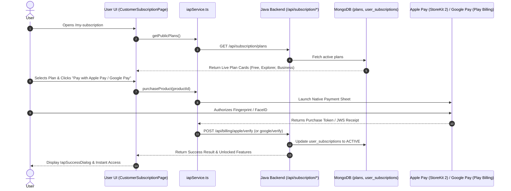

# User UI Subscription & Payment Integration — Implementation Plan

**Target Repository:** `D:\AIS\updated_AitravelGlobecode_final\updated_AitravelGlobecode_final\frontend`

---

## 1. Overview & Architectural Goals
This plan details the exact files, components, services, and routes to add to the **User UI** (`D:\AIS\updated_AitravelGlobecode_final\updated_AitravelGlobecode_final\frontend`) so that end users can view plans created in MongoDB by Admins, select a plan, trigger native payment checkout (Apple Pay / Google Pay), and instantly access subscribed features.

---

## 2. File-by-File Implementation Blueprint

```
D:\AIS\updated_AitravelGlobecode_final\updated_AitravelGlobecode_final\frontend\
├── src/
│   ├── features/
│   │   └── subscriptions/
│   │       ├── services/
│   │       │   └── iapService.ts              <-- [NEW] Native Store & Backend API Service
│   │       ├── components/
│   │       │   └── IapSuccessDialog.tsx       <-- [NEW] Post-Purchase Success Popup
│   │       └── pages/
│   │           └── CustomerSubscriptionPage.tsx <-- [NEW] Paywall & Plan Selection Page
│   └── routes/
│       └── index.tsx                          <-- [MODIFY] Add /my-subscription route
```

---

### Step 1: Create Native Store & Backend API Service
**File Path:** `src/features/subscriptions/services/iapService.ts`

**Key Responsibilities:**
1. **Fetch MongoDB Plans:** Call `GET /api/subscription/plans` to fetch live active plans from MongoDB.
2. **Fetch User Status:** Call `GET /api/subscription/me` to get active subscription status and usage quota progress.
3. **Platform Runtime Detection:** Check if app is running on iOS (`Apple Pay`), Android (`Google Pay`), or Web Browser.
4. **Native Payment Launcher:** Call native JS bridge (`window.webkit.messageHandlers.purchaseProduct` for iOS, `window.AndroidIAPBridge.purchaseProduct` for Android).
5. **Backend Verification Calls:**
   - Apple: `POST /api/billing/apple/verify`
   - Google: `POST /api/billing/google/verify`
   - Restore: `POST /api/billing/restore`

---

### Step 2: Create Success Confirmation Dialog Component
**File Path:** `src/features/subscriptions/components/IapSuccessDialog.tsx`

**Key Responsibilities:**
1. Renders a celebration dialog upon successful payment verification.
2. Displays active plan name, store badge (`Apple Pay` / `Google Pay`), and unlocked feature checklist (PDF Exports, Offline Downloads, Higher AI Quotas).
3. Provides a button to return to the Dashboard or AI Trip Planner.

---

### Step 3: Create Main Subscription & Paywall Page
**File Path:** `src/features/subscriptions/pages/CustomerSubscriptionPage.tsx`

**Key Responsibilities:**
1. **Live MongoDB Plan Rendering:** Maps over plans fetched from MongoDB and renders styled plan cards.
2. **Billing Cycle Selector:** Monthly vs Yearly toggle (calculates 20% annual discount).
3. **Usage Meters:** Progress bars showing resource usage (e.g. `AI_GENERATIONS: 14 / 100`).
4. **Platform Payment Buttons:**
   - On iOS: Renders **`[  Pay with Apple Pay ]`**
   - On Android: Renders **`[ G Pay with Google Pay ]`**
   - On Web: Renders **`[ Subscribe Now ]`**
5. **Restore Purchases Action:** Header button allowing users to restore previous purchases.
6. **Legal Disclosures:** Auto-renewal terms, 24-hour cancellation rules, and Privacy Policy / Terms of Service links.

---

### Step 4: Register Route in React Router
**File Path:** `src/routes/index.tsx`

**Changes Required:**
Add route definition under authenticated layout:
```tsx
{
  path: 'my-subscription',
  element: <Suspense fallback={<LoadingFallback />}><CustomerSubscriptionPage /></Suspense>,
}
```

---

## 3. Data Integration Flow



---

## 4. Verification & Testing Steps

1. **Fetch Test:** Open `/my-subscription` in User UI. Confirm plans created in Admin UI reflect in real-time.
2. **Billing Toggle Test:** Switch between Monthly and Annual pricing; verify price calculations update.
3. **Checkout Test:** Click purchase button -> Confirm receipt sent to `/api/billing/apple/verify` or `/api/billing/google/verify`.
4. **Activation Test:** Verify status changes to `ACTIVE` and `IapSuccessDialog` appears.
